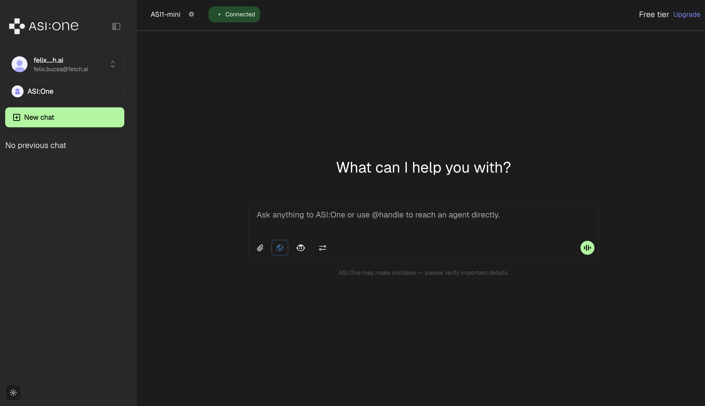
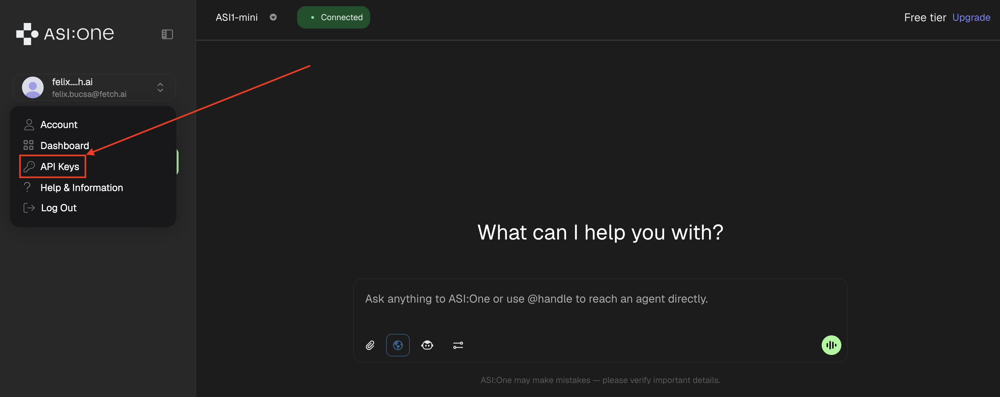
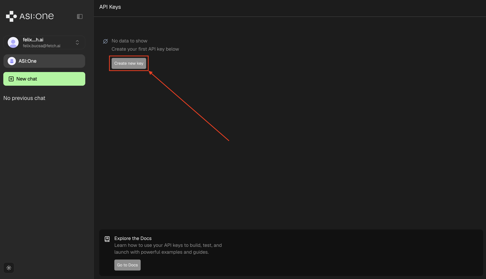
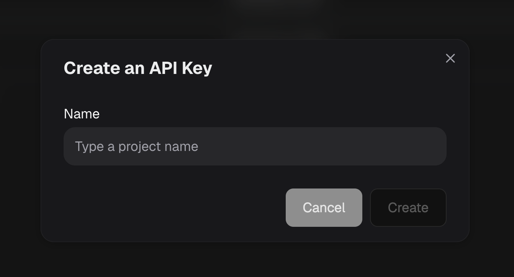
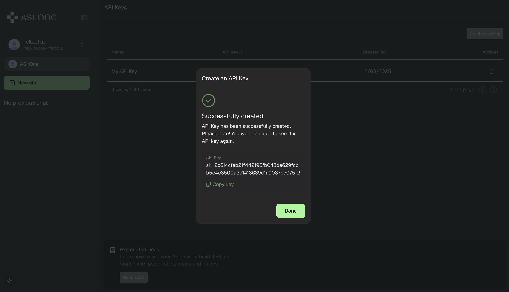

# How to get an API key

Visit [ASI:One](https://asi1.ai/chat) and login.

Click on your account box in the top left corner:

Select **API Keys**:

Click **Create new Key**.

Provide a name that makes sense to you and your project:

Then, click **Create**.

You'll now see a window which displays your API key:

Copy this API key and keep it safe!

Now you have your API key. You can manage the newly created key within the [Dashboard](https://asi1.ai/dashboard/api-keys).
